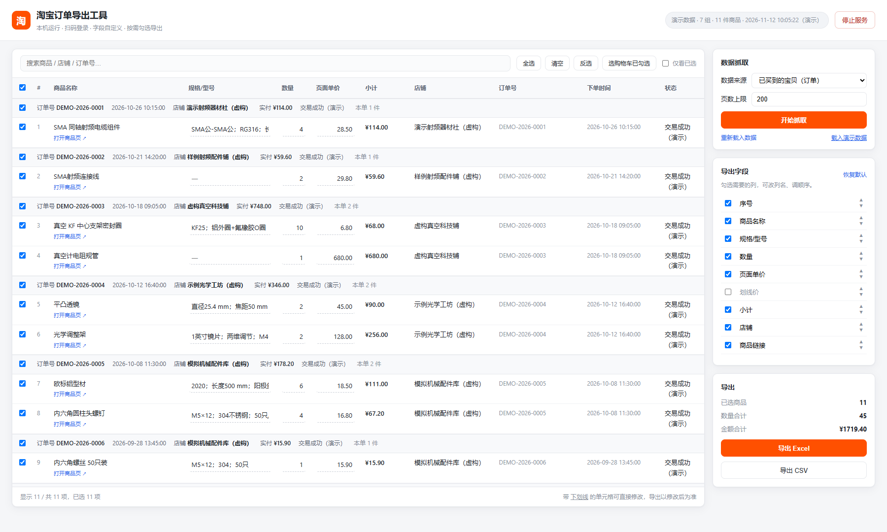
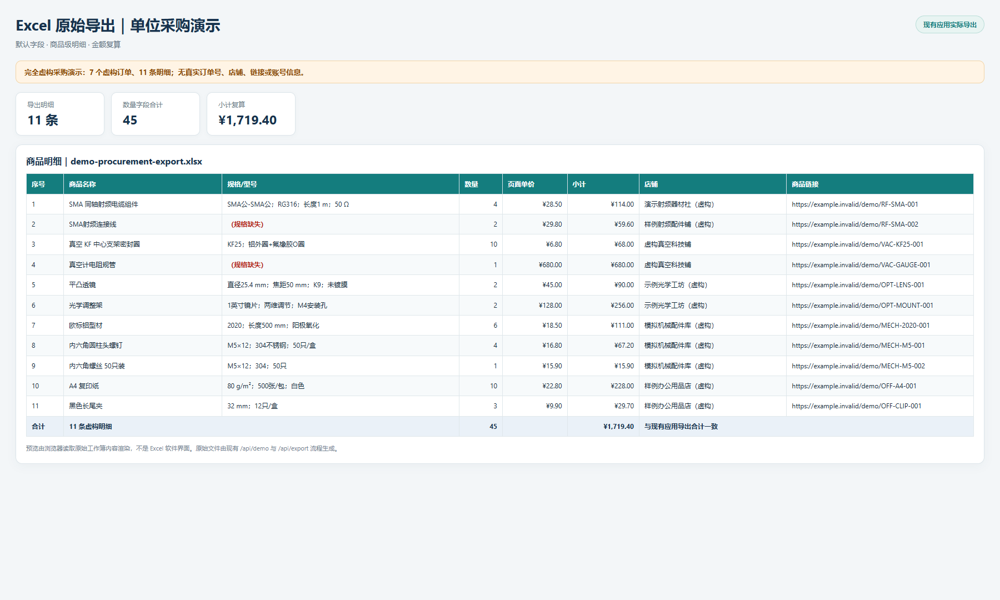
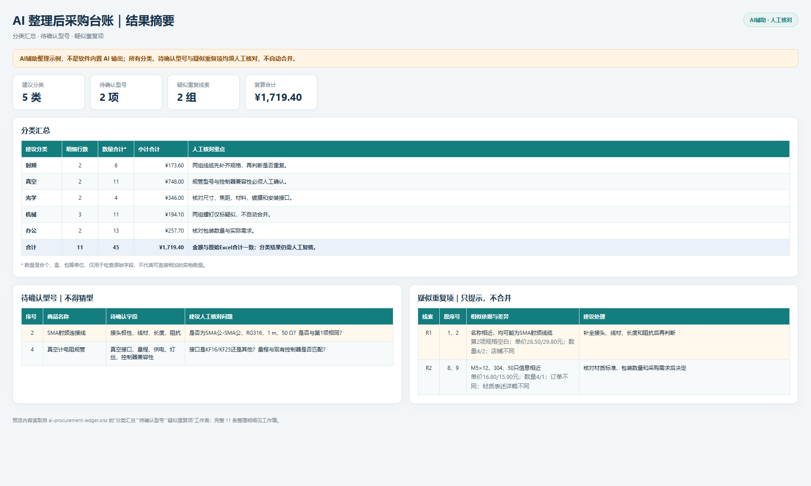

# 淘宝订单与购物车导出工具

一个完全在本机运行的 Windows 小工具：使用自己的 Chrome / Edge 扫码登录淘宝，读取「已买到的宝贝」或「购物车」，勾选商品并自定义字段，导出为 Excel / CSV。

> 非淘宝官方工具。仅用于导出你自己账号中已有权查看的数据，不绕过验证码、登录或平台安全限制。页面结构变化可能影响抓取，请在导出后抽查数据。

## 单位采购整理示例（完全虚构）

面向实验室、课题组和办公采购：把订单中的射频、真空、光学、机械与办公用品导出为 Excel，再另行借助 AI 整理分类、待确认型号和疑似重复项。内置演示包含 **7 个虚构订单、11 条采购明细**，不含真实账号、店铺或商品链接。

**[Release 下载](https://github.com/Powell-Wu/taobao-export/releases/latest)** · **[查看 AI 整理教程与提示词](docs/ai-procurement-example.md)** · [原始 Excel](docs/assets/demo-procurement-export.xlsx) · [AI 整理台账](docs/assets/ai-procurement-ledger.xlsx)

启动后点击右侧 **「载入演示数据」**，即可在不登录淘宝的情况下体验勾选、字段配置和导出。



| Excel 原始导出预览 | AI 整理后采购台账预览 |
| --- | --- |
|  |  |

> AI 整理是导出后的独立辅助步骤，**不是软件内置 AI 功能**。示例结果已标明「AI 辅助、人工核对」，不会自动补造型号或合并疑似重复项。结果图片为浏览器根据实际工作簿内容生成的预览。

## 功能

- 订单与购物车两种数据源，订单自动翻页，购物车自动滚动加载
- 商品级勾选，也可按订单 / 店铺整组勾选、搜索、反选、仅看已选
- 默认导出：序号、商品名称、规格/型号、数量、页面单价、小计、店铺、商品链接
- 可选字段：划线价、购物车已勾选、订单号、下单时间、订单实付、订单状态、原始文本
- 字段可改名、排序、停用，配置保存在浏览器 localStorage
- 规格、数量、单价可在表格中修正后再导出
- Excel 带筛选、冻结表头、超链接和合计行；CSV 使用 UTF-8 BOM
- 订单、购物车、演示数据分开保存，切换数据源不会互相覆盖
- 本机服务仅监听 `127.0.0.1`，支持控制台或网页一键停止

## 环境要求

- Windows 10 / 11
- Python 3.10 或更高版本
- Chrome 或 Edge
- 首次运行需要联网安装 Python 依赖

不需要安装 Playwright 浏览器内核；工具连接本机已有的 Chrome / Edge。

## 快速开始

1. 下载并解压本仓库。
2. 双击 `启动导出工具.bat`。
3. 首次运行会在项目目录创建 `.venv` 并安装依赖。
4. 浏览器打开 `http://127.0.0.1:8765`，点击「开始抓取」。
5. 在弹出的专用浏览器窗口中扫码登录，等待抓取完成。
6. 勾选商品、调整字段，点击「导出 Excel」或「导出 CSV」。

也可以手动安装：

```bash
python -m venv .venv
.venv\Scripts\python -m pip install -r requirements.txt
.venv\Scripts\python -u app.py
```

## 停止服务

任选一种：

- 在控制台窗口输入 `q` 后按回车；
- 直接关闭控制台窗口；
- 点击网页右上角「停止服务」。

其他控制台指令：`o` 重新打开界面，`h` 显示帮助。

## 数据与隐私

以下内容仅保存在本机，并已由 `.gitignore` 排除：

| 路径 | 内容 |
| --- | --- |
| `.browser-profile/` | 专用浏览器登录态与 Cookie |
| `data/orders.json` | 订单数据 |
| `data/cart.json` | 购物车数据 |
| `data/demo.json` | 演示数据 |
| `out/` | 导出的 Excel / CSV |
| `debug/` | 调试页面快照 |

**不要上传这些目录。** 订单可能包含店铺、订单号、消费记录等个人信息。分享文件前请先检查内容。

抓取脚本只连接本机浏览器和淘宝页面，不依赖第三方数据服务。登录密码不经过脚本；建议始终使用扫码登录。

## 可选配置

如果 Chrome / Edge 安装在非标准位置，可在运行前指定浏览器：

```bat
set TAOBAO_EXPORT_BROWSER=D:\Path\to\chrome.exe
启动导出工具.bat
```

## 故障排查

- **提示端口 8765 被占用**：说明已有实例在运行。关闭旧控制台窗口，或直接使用已打开的页面。
- **一直等待登录**：在专用浏览器窗口完成扫码；默认等待 10 分钟。
- **抓不到商品或字段为空**：淘宝可能调整了页面结构。请先确认浏览器页面本身能正常显示，再提交 issue 说明页面类型和现象。
- **首次安装依赖失败**：检查网络和 Python 版本，然后重新双击启动脚本。
- **控制台乱码**：请使用仓库最新启动脚本；脚本已统一 UTF-8 环境。

## 测试

测试使用隔离的临时目录，不读取浏览器，也不写入真实订单数据：

```bash
python -m unittest discover -s tests -v
node --check static/app.js
```

## 发布说明

当前版本：**v1.1.0**

- 新增完全虚构的单位采购演示：7 个订单、11 条器件与办公用品明细
- 新增原始 Excel、AI 整理台账、结果截图和独立 AI 整理教程
- 修复演示数据按钮请求方式，并避免测试导入应用时读取本地数据快照
- 保留订单与购物车导出、自定义字段、商品筛选、在线修正及数据隔离能力

历史版本 v1.0.0：首个正式发布版，包含参数校验、公式注入防护、导出文件名防冲突、端口占用提示、可移植 Windows 启动器与自动化回归测试。

## 许可证

本项目基于 [MIT License](LICENSE) 发布。
